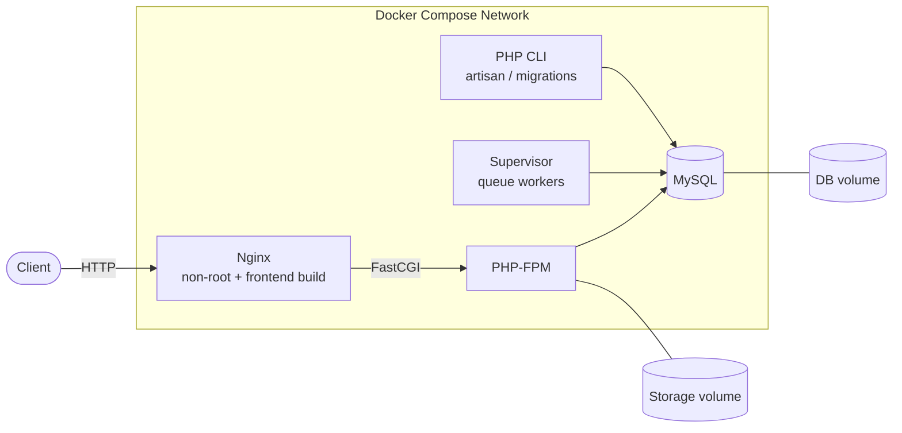

# PHP-Docker: From Manual Deployment to a Secured, Containerized Laravel Stack

A DevOps project that takes an existing Laravel application (codebase from 2021, PHP 8.0) from a manual Ubuntu deployment to a fully containerized stack with a CI pipeline that runs SAST and DAST on every push. Cloud deployment on AWS with Terraform is in progress.

The focus of this repository is the infrastructure around the app: how it is built, isolated, scanned, and shipped. The application code itself is not the point.

## Table of Contents

- [Architecture](#architecture)
- [Tech Stack](#tech-stack)
- [Repository Structure](#repository-structure)
- [Getting Started](#getting-started)
- [Project Phases](#project-phases)
- [Challenges and Solutions](#challenges-and-solutions)
- [Known Limitations](#known-limitations)
- [Roadmap](#roadmap)

## Architecture



All services run on an internal Compose network and reach each other by service name through Docker's internal DNS. No IP addresses are hardcoded anywhere. Database data and user uploads live in volumes outside the containers, so they survive container recreation.

## Tech Stack

| Area | Tools |
|---|---|
| Web / App | Nginx, PHP-FPM 8.0, Laravel, MySQL |
| Process management | Supervisor (queue workers) |
| Containers | Docker (multi-stage builds), Docker Compose |
| CI | GitHub Actions (GitHub-hosted and self-hosted runners) |
| SAST | Trivy (filesystem and image scans), Semgrep, SonarQube |
| DAST | OWASP ZAP |
| Cloud (in progress) | AWS, Terraform |

## Repository Structure

> Adjust this section to match the actual layout of the repository.

```
.
├── docker/                 # Dockerfiles and service configs (fpm, cli, supervisor, nginx)
├── .github/workflows/      # CI pipeline (build, SAST, DAST)
├── docker-compose.yml      # Full stack definition
├── .trivyignore            # Documented vulnerability exceptions
└── README.md
```

## Getting Started

### Prerequisites

- Docker and Docker Compose v2

### Run the stack

```bash
git clone https://github.com/manal333/PHP-Docker.git
cd PHP-Docker

# Create your environment file (see the variables listed in docker-compose.yml)
cp .env.example .env

docker compose up --build
```

> Replace the commands above with the exact steps your repository requires (env file name, migration command, port).

The application should be available at `http://localhost:<PORT>`.

## Project Phases

### Phase 1: Manual deployment on Ubuntu Server

Before using Docker, the app was deployed directly on an Ubuntu server in a production-like way:

- Nginx, PHP-FPM, Supervisor, and MySQL, each with its own hand-written config file
- A **dedicated PHP-FPM pool and socket** for the app, so that other apps can share the same server with proper isolation
- A dedicated database and database user for the app, followed by migrations
- Storage separated from the project directory and linked through a symlink, so uploaded data survives new deployments
- File ownership and permissions fixed for the user running the app, instead of using `chmod 777`

### Phase 2: Containerization

The manual setup was not reproducible: anyone deploying it had to work out compatible PHP and Node versions by reading `composer.json` and `package.json`. Docker removes that guesswork.

- Separate Dockerfiles for **PHP-FPM**, **PHP CLI**, **Supervisor**, and **Nginx** (with the frontend build included)
- The official PHP images cover FPM and CLI, but there is no Supervisor example, so that Dockerfile and its config and entrypoint were written from scratch
- **Multi-stage builds** everywhere: build tools such as Composer, Node, and webpack stay in a throwaway stage and never reach the final image
- **Non-root users** in every container (see challenges below)
- **Docker Compose** ties everything together with an internal network, service-name DNS, and volumes

### Phase 3: CI pipeline with SAST

A GitHub Actions pipeline runs on every push: build Docker images and Compose stack, after static analysis.

| Tool | Purpose |
|---|---|
| **Trivy (filesystem)** | Scans `composer.lock` and `package-lock.json` for vulnerable dependencies |
| **Trivy (image)** | Scans OS packages and libraries inside the built images |
| **Semgrep** | Looks for insecure code patterns |
| **SonarQube** | Bugs, code smells, security hotspots, and a quality gate |

Every stage exits with code `1` on failure, which stops the pipeline. Trivy results are exported in **SARIF** format and appear in the repository's Security tab.

SonarQube runs as a Docker container on a private Ubuntu server, so the pipeline uses a **self-hosted runner** to reach it. The Sonar token is stored as a GitHub Actions secret.

### Phase 4: DAST

**OWASP ZAP** attacks the running application. The pipeline builds the stack with Docker Compose first, then runs ZAP against it. Unlike SAST, this finds what is actually exposed from the outside, such as missing headers and open endpoints.

### Phase 5: Cloud and Terraform (in progress)

Infrastructure as code on AWS using Terraform. Architecture and details will be added here when this phase is complete.

## Challenges and Solutions

| Problem | Root cause | Solution |
|---|---|---|
| Frontend would not build, PHP conflicts | The app needed older PHP and Node versions than the ones installed; lock files pin packages, not the runtime | Found compatible versions manually, then pinned them in Docker images |
| Uploaded data at risk during deployments | Uploads were stored inside the public folder, which gets replaced | Moved storage outside the project and linked it with a symlink; later, a Docker volume |
| Laravel could not write to `storage` | Project folder was owned by root | Changed ownership to the app user and kept least-privilege permissions |
| Root user inside containers | Containers run as root by default | Added `USER` to every Dockerfile |
| Nginx would not run as non-root | Non-root users cannot bind ports below 1024, and the official image assumes root | Used an unprivileged Nginx image and a higher listen port |
| Thousands of Trivy findings | 2021 codebase with old base images and dependencies | Switched Nginx to Alpine, updated and upgraded packages in the other images: the report dropped from about 160k lines to about 50k, and the fixable vulnerabilities from over a thousand to a handful |
| Pipeline failed at random stages | Not a tool problem: the local machine ran out of disk space on the C partition, which crashed WSL | Moved WSL and Docker storage to another partition and added cleanup at the end of every run |
| `404 Not Found` from apt on AWS | Debian 11 Bullseye LTS ended on 31 August, and `bullseye-security` metadata pointed to missing packages in the archive | Pointed APT to `archive.debian.org` as a temporary fix |

## Known Limitations

These are documented deliberately rather than hidden.

- **PHP 8.0 is end-of-life.** It is the root cause of most of the vulnerabilities reported by Trivy and of the Debian Bullseye dependency. The proper fix is upgrading PHP and the base images, which is a larger migration of the application itself.
- **`archive.debian.org` receives no security updates.** It fixed the build, but images built this way will not get patches. This is acceptable as a temporary build fix and not for production.
- **Some vulnerabilities have no upstream fix** (affected, fix deferred, or will not fix). These are listed in `.trivyignore`. In a team setting, each would become a ticket with a risk owner.
- **Images depend on external repositories at build time.** A build that works today may fail later if upstream changes. Storing built images in a registry removes this dependency.

## Roadmap

- [ ] AWS infrastructure with Terraform
- [ ] Push built images to a registry (ECR) instead of rebuilding on each machine
- [ ] Document each `.trivyignore` entry with a reason and a review date
- [ ] Restrict the self-hosted runner to trusted events and require approval for workflows from forks
- [ ] Upgrade PHP and base images to supported versions
- [ ] Monitoring and logging

## Author

**Manal**: DevOps Engineering Intern
GitHub: [@manal333](https://github.com/manal333)